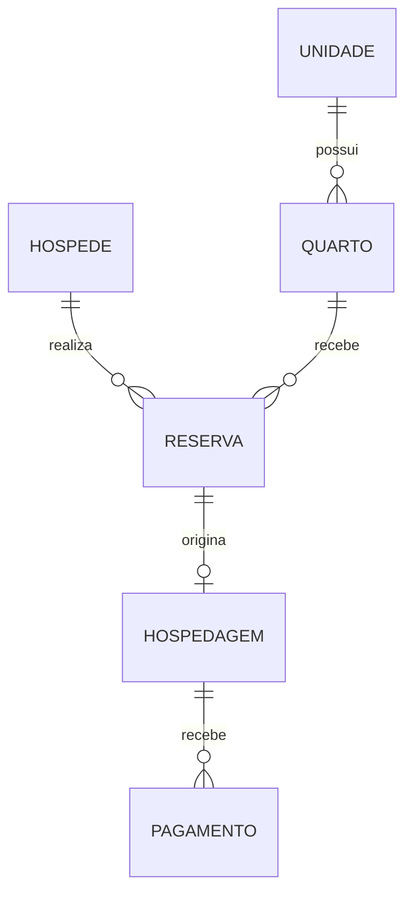
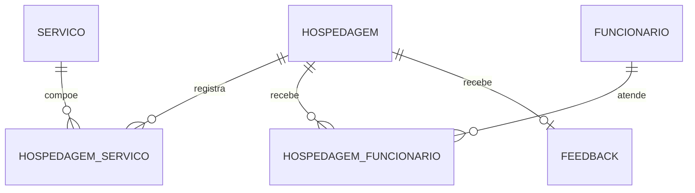

# ✦ Parte 1 — Origem do Sistema

## Escopo e decisões

Banco relacional para uma rede hoteleira, com **duas unidades fictícias** nos dados de teste. Cada reserva é de um quarto e tem um hóspede responsável; acompanhantes são representados pela quantidade de hóspedes. Uma viagem com vários quartos deve gerar várias reservas.

Todos os preços deste projeto são em **BRL**. A implementação física usa MySQL 8.0.16+ e InnoDB.

## Modelo conceitual — reservas e hospedagens

A reserva representa o planejamento da estadia. A hospedagem representa sua realização. Portanto, **uma reserva pode não gerar hospedagem**: isso acontece, por exemplo, quando é cancelada ou quando o hóspede ainda não chegou. A hospedagem sempre pertence a uma reserva.

## Modelo conceitual — atendimento, consumo e avaliação

Cada profissional pode atender várias hospedagens, e uma hospedagem pode ter vários profissionais. A tabela de associação registra a função exercida. Cada consumo de serviço registra quantidade, preço histórico e data; o mesmo serviço pode ser consumido várias vezes na mesma hospedagem.

O feedback aponta para a hospedagem. O hóspede e o quarto são recuperados pela reserva, evitando repetir essas duas referências e associar uma avaliação a um quarto ou hóspede incompatível.

## Entidades e relacionamentos

| Entidade | Finalidade | Relacionamentos |
|---|---|---|
| `unidades` | Identificar cada hotel da rede | Uma unidade possui vários quartos |
| `hospedes` | Cadastrar o responsável pela reserva | Um hóspede realiza várias reservas |
| `quartos` | Registrar categoria, capacidade, diária e condição operacional | Um quarto pertence a uma unidade e recebe várias reservas ao longo do tempo |
| `reservas` | Registrar datas previstas, ocupantes, status e diária contratada | Uma reserva pertence a um hóspede e um quarto; gera no máximo uma hospedagem |
| `hospedagens` | Registrar entrada e saída reais | Uma hospedagem recebe pagamentos, consumos, atendimentos e no máximo um feedback |
| `pagamentos` | Registrar recebimentos e tentativas | Vários pagamentos podem pertencer à mesma hospedagem |
| `funcionarios` | Cadastrar profissionais | Relacionamento N:N com hospedagens |
| `servicos` | Cadastrar os serviços extras oferecidos | Relacionamento N:N com hospedagens, por eventos de consumo |
| `hospedagem_servicos` | Registrar cada consumo de serviço | Liga uma hospedagem a um serviço |
| `hospedagem_funcionarios` | Registrar os profissionais responsáveis por atendimentos | Liga uma hospedagem a um funcionário |
| `feedbacks` | Registrar nota e comentário após a estadia | Cada feedback pertence a uma hospedagem |

## Regras de negócio

1. O e-mail do hóspede é obrigatório e único; CPF é opcional e, quando informado, único. Validar o formato dos documentos é responsabilidade da aplicação.
2. O número do quarto é único **dentro da unidade**, permitindo o quarto 101 em hotéis diferentes.
3. A capacidade e a diária do quarto são positivas. `DISPONIVEL` significa operacional; a disponibilidade em uma data depende das reservas.
4. A saída prevista deve ser posterior à entrada. Os intervalos são tratados como **[entrada, saída)**: o check-out de uma reserva pode ocorrer no dia do próximo check-in.
5. A quantidade de hóspedes deve ser positiva e não ultrapassar a capacidade do quarto.
6. Reservas não canceladas não podem se sobrepor no mesmo quarto. `PENDENTE` também bloqueia o período até confirmação ou cancelamento; não há expiração automática neste escopo.
7. A reserva guarda a diária contratada. Alterar a diária atual do quarto não modifica reservas anteriores.
8. O check-in só deve ocorrer em reserva confirmada. No check-out, a hospedagem passa a `FINALIZADA` e a reserva a `CONCLUIDA`, na mesma transação. Uma reserva com hospedagem iniciada não deve ser cancelada.
9. Uma reserva pode gerar zero ou uma hospedagem. Uma hospedagem em andamento não tem saída real; uma finalizada tem saída posterior à entrada real.
10. Uma hospedagem pode receber vários pagamentos. Pagamentos confirmados e estornados exigem data. O relatório mensal soma somente pagamentos `CONFIRMADO`, pela data do recebimento.
11. O consumo guarda o preço unitário praticado, independentemente de mudanças no catálogo. O valor do consumo é quantidade × preço histórico.
12. Um funcionário pode atender em diferentes unidades da rede. O mesmo profissional é contado uma vez por hospedagem, mesmo que realize várias tarefas; `funcao_atendimento` descreve sua participação principal.
13. Cada hospedagem pode receber uma avaliação, com nota inteira de 1 a 5. A avaliação deve ocorrer após a finalização, pelo responsável pela reserva.
14. Registros relacionados não são apagados em cascata; preservam-se os históricos de estadias, pagamentos e avaliações.

## Modelo lógico relacional

**PK:** chave primária. **FK:** chave estrangeira. **UQ:** chave única. Os identificadores simples são `INT AUTO_INCREMENT`. Os atributos completos, tipos e restrições estão listados abaixo.

### `unidades`

| Coluna | Tipo | Restrições e referência |
|---|---|---|
| `id_unidade` | `INT` | PK |
| `nome` | `VARCHAR(100)` | NOT NULL |
| `cidade` | `VARCHAR(80)` | NOT NULL |
| `estado` | `CHAR(2)` | NOT NULL |
| `endereco` | `VARCHAR(180)` | NOT NULL |

### `hospedes`

| Coluna | Tipo | Restrições e referência |
|---|---|---|
| `id_hospede` | `INT` | PK |
| `nome` | `VARCHAR(100)` | NOT NULL |
| `email` | `VARCHAR(100)` | NOT NULL; UQ |
| `cpf` | `VARCHAR(14)` | UQ |
| `telefone` | `VARCHAR(20)` | Opcional |
| `data_nascimento` | `DATE` | Opcional |
| `nacionalidade` | `VARCHAR(60)` | Opcional |
| `data_cadastro` | `DATETIME` | NOT NULL; DEFAULT CURRENT_TIMESTAMP |

### `quartos`

| Coluna | Tipo | Restrições e referência |
|---|---|---|
| `id_quarto` | `INT` | PK |
| `id_unidade` | `INT` | NOT NULL; FK → `unidades(id_unidade)` |
| `numero` | `VARCHAR(10)` | NOT NULL |
| `tipo` | `VARCHAR(50)` | NOT NULL |
| `capacidade` | `INT` | NOT NULL |
| `preco_diaria` | `DECIMAL(10,2)` | NOT NULL |
| `status` | `VARCHAR(20)` | NOT NULL; DEFAULT 'DISPONIVEL' |
| `descricao` | `VARCHAR(255)` | Opcional |

UQ composta: `(id_unidade, numero)`.

### `funcionarios`

| Coluna | Tipo | Restrições e referência |
|---|---|---|
| `id_funcionario` | `INT` | PK |
| `nome` | `VARCHAR(100)` | NOT NULL |
| `cargo` | `VARCHAR(50)` | NOT NULL |
| `email` | `VARCHAR(100)` | NOT NULL; UQ |
| `telefone` | `VARCHAR(20)` | Opcional |
| `data_admissao` | `DATE` | NOT NULL |
| `ativo` | `BOOLEAN` | NOT NULL; DEFAULT TRUE |

### `reservas`

| Coluna | Tipo | Restrições e referência |
|---|---|---|
| `id_reserva` | `INT` | PK |
| `id_hospede` | `INT` | NOT NULL; FK → `hospedes(id_hospede)` |
| `id_quarto` | `INT` | NOT NULL; FK → `quartos(id_quarto)` |
| `data_checkin` | `DATE` | NOT NULL |
| `data_checkout` | `DATE` | NOT NULL |
| `quantidade_hospedes` | `INT` | NOT NULL; DEFAULT 1 |
| `valor_diaria` | `DECIMAL(10,2)` | NOT NULL |
| `status` | `VARCHAR(20)` | NOT NULL; DEFAULT 'PENDENTE' |
| `data_reserva` | `DATETIME` | NOT NULL; DEFAULT CURRENT_TIMESTAMP |
| `motivo_cancelamento` | `VARCHAR(255)` | Opcional |
| `observacoes` | `VARCHAR(255)` | Opcional |

### `hospedagens`

| Coluna | Tipo | Restrições e referência |
|---|---|---|
| `id_hospedagem` | `INT` | PK |
| `id_reserva` | `INT` | NOT NULL; UQ; FK → `reservas(id_reserva)` |
| `checkin_real` | `DATETIME` | NOT NULL |
| `checkout_real` | `DATETIME` | Opcional |
| `status` | `VARCHAR(20)` | NOT NULL; DEFAULT 'EM_ANDAMENTO' |

### `pagamentos`

| Coluna | Tipo | Restrições e referência |
|---|---|---|
| `id_pagamento` | `INT` | PK |
| `id_hospedagem` | `INT` | NOT NULL; FK → `hospedagens(id_hospedagem)` |
| `valor` | `DECIMAL(10,2)` | NOT NULL |
| `metodo` | `VARCHAR(30)` | NOT NULL |
| `status` | `VARCHAR(20)` | NOT NULL; DEFAULT 'PENDENTE' |
| `data_pagamento` | `DATETIME` | Opcional |
| `referencia` | `VARCHAR(60)` | NOT NULL; UQ |

### `servicos`

| Coluna | Tipo | Restrições e referência |
|---|---|---|
| `id_servico` | `INT` | PK |
| `nome` | `VARCHAR(80)` | NOT NULL; UQ |
| `descricao` | `VARCHAR(255)` | Opcional |
| `preco_atual` | `DECIMAL(10,2)` | NOT NULL |
| `ativo` | `BOOLEAN` | NOT NULL; DEFAULT TRUE |

### `hospedagem_servicos`

| Coluna | Tipo | Restrições e referência |
|---|---|---|
| `id_consumo` | `INT` | PK |
| `id_hospedagem` | `INT` | NOT NULL; FK → `hospedagens(id_hospedagem)` |
| `id_servico` | `INT` | NOT NULL; FK → `servicos(id_servico)` |
| `quantidade` | `INT` | NOT NULL |
| `preco_unitario` | `DECIMAL(10,2)` | NOT NULL |
| `data_consumo` | `DATETIME` | NOT NULL |

### `hospedagem_funcionarios`

| Coluna | Tipo | Restrições e referência |
|---|---|---|
| `id_hospedagem` | `INT` | NOT NULL; FK → `hospedagens(id_hospedagem)` |
| `id_funcionario` | `INT` | NOT NULL; FK → `funcionarios(id_funcionario)` |
| `funcao_atendimento` | `VARCHAR(60)` | NOT NULL |

PK composta: `(id_hospedagem, id_funcionario)`; ambas as colunas são obrigatórias.

### `feedbacks`

| Coluna | Tipo | Restrições e referência |
|---|---|---|
| `id_feedback` | `INT` | PK |
| `id_hospedagem` | `INT` | NOT NULL; UQ; FK → `hospedagens(id_hospedagem)` |
| `nota` | `INT` | NOT NULL |
| `comentario` | `VARCHAR(500)` | Opcional |
| `data_feedback` | `DATETIME` | NOT NULL; DEFAULT CURRENT_TIMESTAMP |

## O que cada mecanismo garante

| Mecanismo | Garantia |
|---|---|
| `PRIMARY KEY` e `UNIQUE` | Identificadores sem repetição; e-mail único; número por unidade; uma hospedagem por reserva; um feedback por hospedagem |
| `FOREIGN KEY` | Impede referências a hóspedes, quartos, reservas e outros registros inexistentes |
| `CHECK` e `NOT NULL` | Limites de notas, valores, quantidades, status permitidos e coerência de datas dentro de cada linha |
| Procedimento `registrar_reserva` | Confere capacidade, condição operacional e sobreposição; bloqueia o quarto durante a criação para serializar chamadas concorrentes |
| Aplicação/API futura | Autorização do autor do feedback; avaliação somente após check-out; consistência dos status de reserva e hospedagem; alterações de período e cancelamento; conciliação de saldo |

`CHECK` não compara dados de tabelas diferentes. A criação de reservas deve passar por `registrar_reserva`; INSERTs diretos e mudanças de período por UPDATE não passam pelas verificações do procedimento. Em uma API, essas operações devem usar o mesmo bloqueio transacional e restringir a escrita direta. O procedimento deve ser chamado fora de uma transação já aberta, pois controla sua própria transação.

A consulta de disponibilidade usa **datas previstas**. Se houver prorrogação ou atraso na saída, a reserva deve ser atualizada antes de ofertar o quarto. O modelo não inclui calendário de manutenção por período, expiração de reservas pendentes, identificação individual dos acompanhantes, estorno parcial nem emissão fiscal.

O relatório chamado “faturamento” usa o critério de **caixa**: recebimentos confirmados no mês. Um pagamento integralmente estornado deixa de aparecer no seu mês de origem. Não é uma apuração contábil por competência nem um fluxo líquido de estornos por data.

## Referências técnicas

- [MySQL — restrições CHECK](https://docs.oracle.com/cd/E17952_01/mysql-8.0-en/create-table-check-constraints.html)
- [MySQL — leituras com bloqueio](https://docs.oracle.com/cd/E17952_01/mysql-8.0-en/innodb-locking-reads.html)
